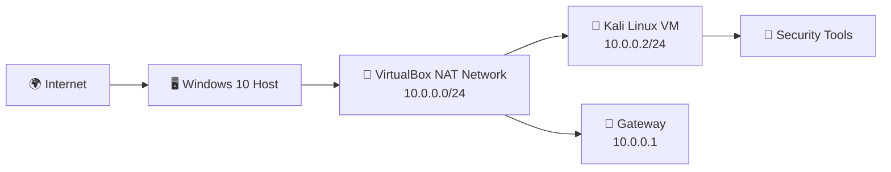
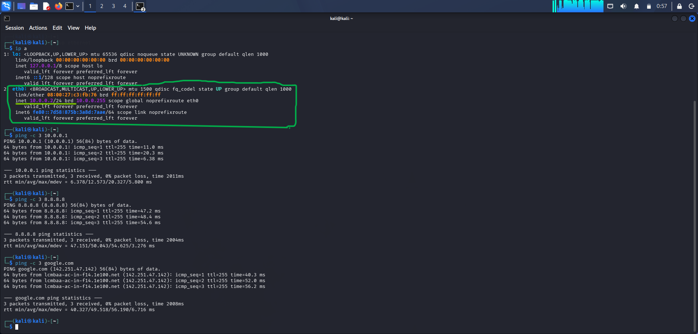
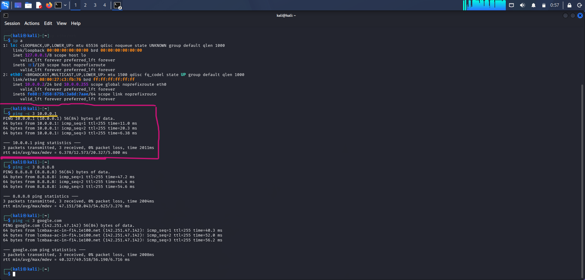
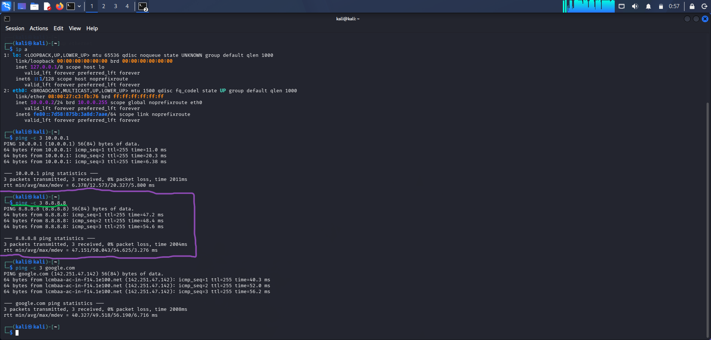

# 🛡️ Cybersecurity Lab Setup — Nairobi

<p align="center">
  
</p>

<p align="center">
  
  
  
</p>

> **A hands-on cybersecurity homelab built to understand networking fundamentals, not just follow commands.**

## ⚡ Lab Snapshot

| Component | Configuration |
| --- | --- |
| **Author** | Alvin Supeeti Karkures — Cybersecurity Student, Nairobi |
| **Host OS** | Windows 10 Home on Fujitsu Lifebook U938 |
| **Hardware** | Intel Core i5 7th Gen · 8 GB RAM · 256 GB SSD |
| **Virtualization** | Oracle VirtualBox 7.x · NAT Network |
| **Lab OS** | Kali Linux 2026.x |
| **Network** | `10.0.0.0/24` · Kali: `10.0.0.2` · Gateway: `10.0.0.1` |
| **DNS** | `8.8.8.8` |

## 🎯 Lab Goal

Set up an isolated cybersecurity lab with static IP `10.0.0.2/24`, while retaining internet connectivity for tools and updates.

## 🌐 Lab Architecture



## 🚀 Setup Steps

<details open>
<summary><strong>1. Create the VirtualBox network</strong></summary>

1. Open **VirtualBox → Tools → Network Manager**.
2. Create a NAT Network using `10.0.0.0/24`.
3. Apply the configuration.

</details>

<details>
<summary><strong>2. Configure Kali Linux</strong></summary>

```bash
sudo nmcli con del ethernet
sudo nmcli con add type ethernet con-name ethernet ifname eth0 \
  ipv4.addresses 10.0.0.2/24 \
  ipv4.gateway 10.0.0.1 \
  ipv4.dns 8.8.8.8 \
  ipv4.method manual
sudo nmcli con mod ethernet ipv4.dad-timeout 0
sudo nmcli con up ethernet
```

</details>

## 🧩 Problems Faced & Fixes

<details>
<summary><strong>🔴 Problem 1 — Destination Host Unreachable</strong></summary>

**Cause:** Kali was configured for `10.0.0.2`, while VirtualBox was still using `10.0.2.0/24`.

**Fix:** Changed the VirtualBox IPv4 prefix to `10.0.0.0/24`.

</details>

<details>
<summary><strong>🟠 Problem 2 — 10.0.0.2 Reserved Conflict</strong></summary>

`10.0.0.2` can be reserved by VirtualBox NAT/DHCP. The setting below bypasses Duplicate Address Detection:

```bash
sudo nmcli con mod ethernet ipv4.dad-timeout 0
```

</details>

<details>
<summary><strong>🟡 Problem 3 — Copy/Paste Not Working</strong></summary>

- Use **Ctrl+Shift+C** and **Ctrl+Shift+V** in the Kali terminal.
- Enable **Devices → Shared Clipboard → Bidirectional**.
- Enable **Devices → Drag and Drop → Bidirectional**.

</details>

<details>
<summary><strong>🔵 Problem 4 — GUI Disconnected, Internet Working</strong></summary>

The network icon showed **Disconnected**, even though `ping 8.8.8.8` worked. The lesson: trust terminal evidence such as `ip a` and `ping` over a misleading GUI status indicator.

</details>

## ✅ Verification Evidence

### Network interface



### Gateway connectivity



### Internet and DNS connectivity



### Kali Linux desktop

.png)

## 💡 Lessons Learned

Building a lab is not just installing software — it is debugging networking fundamentals. Checking VirtualBox NAT settings before configuring Kali saved hours of troubleshooting.

<div align="center">
  <br />
  
</div>

<sub>Inspired by instructor samples; all IPs, specifications, and troubleshooting notes are from my own lab and laptop.</sub>
